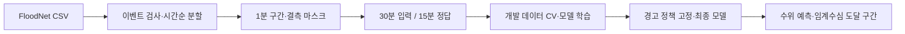

# 침수탈출넘버완 · Flood Risk Prediction

FloodNet 침수 관측 데이터로 **최근 30분의 외부 수위를 입력받아 향후 1~15분 수위를 예측**하는 MEIT 프로젝트다. 데이터 전처리부터 기준 모델 비교, LSTM 학습, 경고 임계값 선택과 추론까지의 Python 코드를 포함한다.

## 예측 문제

| 항목 | 구성 |
| --- | --- |
| 데이터 | FloodNet 이벤트별 외부 수위 시계열 (`export.csv`) |
| 시간 간격 | 1분, 완료된 구간의 마지막 유효 관측값 |
| 입력 | 최근 30분 외부 수위, `(B, 30, 1)` |
| 출력 | 향후 1~15분 외부 수위, `(B, 15, 1)` |
| 단위 | 원본 inches → 전처리·예측 m |
| 모델 | 단층 LSTM, hidden size 64 + Linear(64, 15) |
| 비교 기준 | 현재 수위 유지, 최근 5분 선형 외삽 |



## 현재 상태

저장된 개발 결과는 `floodnet-391a996-canonical-v1` 데이터 버전을 기준으로 한다.

- 고정된 시간순 CV 4개 fold와 seed 42·43·44로 학습한 12개 모델을 검토했다.
- 최종 모델은 개발 데이터 121,913개 창으로 14 epoch 학습했다.
- 고정한 외부 수위 예측 경고 임계값과 실제 crossing 기준은 각각 0.30m다.
- **객관적인 최종 성능 검증은 새 holdout 확보 전까지 보류 상태다.** 기존 `test_risk`, `test_temporal`은 이미 열어본 자료이므로 탐색 결과로만 해석한다.

수치와 학습 근거는 [학습 요약](analysis/a_plan_training_summary.json), [모델 배포 기록](docs/a_plan_model_release.md)에 있다. 학습 가중치와 개별 실험 산출물은 `artifacts/`에 로컬로 보관하며 Git에 포함하지 않는다. 따라서 새 clone에는 학습된 체크포인트가 없다.

## 설치

Python 3.10 이상이 필요하다. 저장소 루트에서 실행한다.

```bash
git clone https://github.com/leew0nkim/flood-risk-prediciton.git
cd flood-risk-prediciton
python3 -m venv .venv
source .venv/bin/activate
python -m pip install -e ".[torch]"
```

Windows PowerShell에서는 가상환경을 `python -m venv .venv`로 만들고 `.venv\Scripts\Activate.ps1`로 활성화한다. 전처리만 사용할 경우 `python -m pip install -e .`로 NumPy와 pandas만 설치할 수 있다.

## 데이터 검증

저장소에는 원본 CSV와 해시로 고정한 전처리 데이터가 포함되어 있다. 아래 명령은 데이터 구조·해시·Loader 연결을 확인한다.

```bash
python -m meit_data --verify-only
python -m meit_model.check_data_pipeline
python -m meit_model.final_evaluation_gate
python -m unittest discover -s tests -v
```

`final_evaluation_gate`는 데이터 버전과 최종 평가 자료의 등록 상태를 출력한다. 새 holdout이 등록되지 않은 상태에서 명령이 성공해도 최종 모델 성능이 검증됐다는 뜻은 아니다.

| split | 샘플 수 | 현재 용도 |
| --- | ---: | --- |
| `train` | 97,056 | 개발·학습 |
| `validation` | 24,857 | 개발·교차검증 |
| `test_temporal` | 20,478 | 기존 탐색 결과 참고 |
| `test_risk` | 7,962 | 기존 탐색 결과 참고 |

정규화는 학습에 사용되는 실측 구간만으로 계산한다. CV에서는 각 fold의 학습 자료로 다시 계산하며, 검증·시험 자료로 정규화 계수를 학습하지 않는다. 해시를 유지하기 위해 `data/processed/`의 바이트·줄바꿈을 임의로 수정하지 않는다.

## 전처리 다시 실행하기

원본 CSV의 배열을 해석하고 inches를 m로 변환한 뒤, 이벤트·날짜 기준 분할과 1분 구간 처리를 수행한다.

- 180초를 초과하는 원본 관측 공백에서 연속 구간을 나눈다.
- 입력 30개 구간 중 실측 27개 이상, 정답 15개 구간 중 실측 14개 이상을 요구한다.
- 입력 결측은 과거 값으로 최대 연속 2개 구간까지만 보완한다. 정답 결측은 보완하지 않고 손실·평가에서 제외한다.

기존 결과를 덮어쓰지 않도록 **존재하지 않는 새 출력 경로**를 지정한다.

```bash
python -m meit_data \
  --source export.csv \
  --config configs/pipeline_config.json \
  --output artifacts/preprocess_run/data \
  --report artifacts/preprocess_run/summary.json
```

새로 생성한 데이터는 별도 실험 버전이다. 기존 배포 계약의 해시를 바꿔 검증을 통과시키지 않는다.

## 모델 학습·추론

개발 데이터로 CV를 생성하고 seed별 학습 → window calibration → 5분 선행 경고 event 평가 → 경고 정책 고정 → 최종 학습 순서로 진행한다. 실행 명령과 필수 산출물은 [모델 선택 절차](docs/model_selection_workflow.md)에 정리되어 있다.

```bash
python -m meit_model.cv \
  --data-dir data/processed \
  --output-dir artifacts/cv_new_run

python -m meit_model.train_risk_lstm_cv \
  --data-dir data/processed \
  --cv-dir artifacts/cv_new_run \
  --output-dir artifacts/risk_cv_new_run_seed42 \
  --seed 42
```

최종 체크포인트는 학습 후 `artifacts/final_model/final_model.pt`에 준비한다. 로컬 보관본을 사용할 경우 [학습 요약](analysis/a_plan_training_summary.json)의 SHA-256과 출처를 확인한다. 예측에는 체크포인트에 저장된 정규화 계수를 사용하며, 입력은 이미 전처리된 m 단위의 1분 수위 30개다.

```python
from meit_model.predictor import ForecastPredictor

predictor = ForecastPredictor("artifacts/final_model/final_model.pt")
recent_depths_m = [0.10] * 30  # 사용 예시: 실제로는 품질 검사를 마친 최근 30분 값
result = predictor.predict(recent_depths_m)
print(result.status)
print(result.predicted_depths_m)
```

## 폴더 구성

```text
.
├── meit_data/       # CSV 검사·전처리·정규화·PyTorch Dataset
├── meit_model/      # 기준 모델·LSTM·CV·경고 정책·추론
├── configs/         # 전처리 설정·고정 데이터 버전 계약
├── data/processed/  # 전처리 배열·마스크·scaler·manifest
├── analysis/        # 데이터 감사·설계 검토·학습 및 탐색 결과
├── docs/            # 예측 파이프라인·모델 선택·검증 문서
├── tests/           # 전처리·학습·추론 회귀 테스트
├── export.csv       # 원본 FloodNet 이벤트 데이터
├── .env.example     # 선택적인 로컬 경로 설정 예시
└── pyproject.toml   # 패키지·의존성·CLI 설정
```

## 로컬 파일 관리

`.env`는 로컬 환경변수 파일이다. PDF, 동의서, 기획안, 압축파일과 비밀값의 Git 제외 규칙은 `.gitignore`에서 관리한다. PDF·압축파일·모델 가중치·캐시·로컬 보관 폴더는 업로드하지 않는다.

경로를 환경변수로 관리하려면 `.env.example`을 복사한다. Python 모듈은 `.env`를 자동으로 읽지 않으므로 Bash/zsh에서는 아래처럼 불러오고 CLI 옵션으로 전달한다. 기본 경로를 사용한다면 이 설정은 생략할 수 있다.

```bash
cp .env.example .env
set -a
source .env
set +a
python -m meit_data --verify-only --output "$MEIT_DATA_DIR"
```

## 관련 문서

- [예측 파이프라인과 데이터 처리 규칙](docs/forecast_pipeline.md)
- [데이터·Loader 연결 확인](docs/stage1_handoff_check.md)
- [CV 정규화 누수 수정](docs/fold_scaling_fix.md)
- [모델 선택과 최종 학습](docs/model_selection_workflow.md)
- [고정 모델 버전과 최종 평가 조건](docs/a_plan_model_release.md)
- [원본 데이터 감사](analysis/floodnet_audit_20260910/dataset_audit.md)

모델 출력은 미래 외부 수위와 임계수심 도달 구간의 추정값이다. 실제 대피 가능시간이나 문 개방 가능성을 검증한 결과로 해석하지 않는다.
