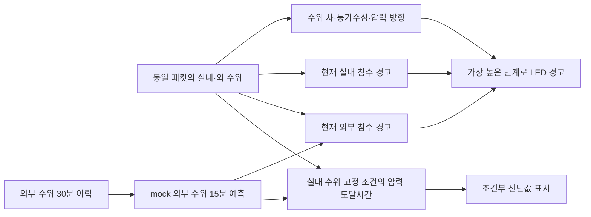

# 실내·외 수위와 수압 차이를 반영한 경고

`risk.py`의 `state`는 LED·음성 경고다. 문을 열 수 있는지의 판정이나 유입구 제어 명령이 아니다.
실제 LSTM을 연동하는 변경은 하지 않았다. 시험 프로그램의 예측은 계속 mock이다.

## 데이터 흐름과 합성 정책



최종 `state = max(external_state, internal_state, pressure_state)`이며 순서는 SAFE < WARNING < DANGER다.
`pressure_state`는 **현재 수압 차이**만 평가한다. 조건부 미래 압력 도달시간은 상태 합성이나 제어에 쓰지 않는다.
외부·내부가 각각 0.50m이면 수압 차이는 0이어도 양쪽 침수 경고는 DANGER다.

| 평가 대상 | WARNING | DANGER | 근거·한계 |
| --- | --- | --- | --- |
| 현재 외부 수위 | ≥0.25m | ≥0.30m | 기존 침수 경고 정책 유지 |
| 미래 외부 수위 | 0.29m 도달이 +6~15분 | 0.29m 도달이 +1~5분 | 기존 외부 예측 경고 정책 유지 |
| 현재 실내 수위 | ≥0.25m | ≥0.30m | 이번에 추가한 보수적 PoC 가정, 실내 대피 실험으로 검증된 기준 아님 |
| 현재 등가수심 크기 | ≥0.30m | ≥0.40m | 0.40m는 기획서 가정, 0.30m는 잠정 사전 경고값 |

높은 단계가 우선이다. 외부 예측이 없거나 잘못되면 최소 WARNING이다. 실내 수위가 없으면 최소 WARNING이며,
외부에서 이미 확인한 DANGER는 유지한다. 단, 직접 API에 NaN·음수·문자열·bool을 주면 ValueError다.
실제 시리얼 프로토콜은 두 수위 모두 필수 숫자이며 누락/null 패킷을 거부한다.

등가수심은 양쪽 수위 중 큰 값 이하이므로, 기본 절대수위 DANGER 0.30m 정책이 등가수심 DANGER 0.40m보다 먼저 작동한다.
따라서 실내 수위 추가가 최종 경고에 미치는 주요 변화는 **실내 침수 누락 방지**이며,
수압 평형의 효과는 `pressure_state`와 등가수심에 별도로 표시된다.
각 임계값은 `RiskEngine` 생성자에서 별도로 설정할 수 있다. 기존 외부 모델의 검증 결과를 물리 임계값 검증으로 전용하지 않는다.

## 왜 단순 gap 대신 등가수심인가

수위는 두 센서 모두 **같은 문 하단**을 0m로 환산한 높이여야 한다. 센서 설치 높이가 같다는 것만으로
보정이 끝나지는 않는다. 보드에서 거리→수위 변환과 영점 보정을 마친 값을 전달한다.

정수압, 동일한 물의 밀도, 수직 직사각형 문, 양쪽 수면이 문 상단 이하인 조건에서:

```text
gap = h_out - h_in                                [m, 부호 있음]
문 하단의 압력 차 = rho * g * gap                 [Pa, 부호 있음]
문 전체의 순수압 힘 = rho * g * width / 2
                      * (h_out² - h_in²)           [N, 부호 있음]
등가수심 크기 = sqrt(abs(h_out² - h_in²))          [m]
```

현재 코드의 밀도 가정은 1000kg/m³, 중력가속도는 9.80665m/s²이다.
`equivalent_depth_m`은 크기이고, 방향은 `OUTSIDE_HIGHER / INSIDE_HIGHER / BALANCED`로 별도 보존한다.
외부가 높은 경우 기획서의 `sqrt(h_out²-h_in²)`와 같다. 실내가 높은 경우에도 역방향 압력을 0으로 버리지 않는다.

예를 들어 `(외부,실내)=(0.20,0)`과 `(0.50,0.30)`은 gap과 문 하단 압력 차가 같다.
그러나 등가수심은 0.20m와 0.40m이고, 같은 폭의 문에 작용하는 순수압 힘의 크기는 뒤쪽이 4배다.
그러므로 gap 하나를 임계값으로 삼으면 문 전체의 하중을 같은 것으로 오판할 수 있다.

실제 힘 N과 손잡이에 필요한 개방력은 출력하지 않는다. 문 폭·높이·힌지·손잡이 위치·마찰 등의 정보가 없기 때문이다.
수면이 문 상단을 넘으면 위 제곱식은 그대로 쓸 수 없다. 현재는 `pressure_status=ASSUMED_PARTIAL_SUBMERGENCE`로
**가정에 따른 계산**임을 표시한다. 실제 치수와 실험으로 검증하기 전에는 문 개방 가능 여부나 자동제어 기준으로 쓰지 않는다.
문 높이 H가 확정되면 각 측면에 `h² (h≤H), 2Hh-H² (h>H)`를 사용한 유한 높이 적분으로 확장해야 한다.

원리 출처: [OpenStax, Hydrostatic Force and Pressure](https://openstax.org/books/calculus-volume-2/pages/2-5-physical-applications).
기획서 근거: 저장소의 `2026 제5회 MEIT 예선 기획안_침수탈출넘버완.pdf` 3~4쪽.
해당 원리 출처는 이 프로젝트의 0.40m 임계값을 검증하는 자료가 아니다.

## 미래 시간 필드의 정확한 의미

| 필드 | 의미 |
| --- | --- |
| `t_warning_min` | 외부 예측이 0.29m에 처음 도달하는 분. 기존 의미 유지 |
| `t_external_critical_min` | 외부 예측이 0.30m에 처음 도달하는 분. 문 개방 한계시간 아님 |
| `t_pressure_critical_if_internal_constant_min` | **실내 수위가 현재 값으로 유지될 때**, 외부가 더 높은 방향의 등가수심이 0.40m에 처음 도달하는 분 |

각 시간은 외부 예측의 기준 시각부터 센다. accumulate에서는 마지막 완료된 1분 bin 끝이 기준이다.
현재 외부 수위가 이미 0.30m 이상이면 기존 두 외부 시간 필드는 0이다.
압력 시간 필드는 정상 외부 예측과 실내 관측이 있고 `equalization_active=False`일 때만 제공한다.
이때 현재 외부 방향 등가수심이 이미 0.40m 이상이면 0이다. None은 조건 내 미도달 또는 계산 불가이므로 상태 필드를 함께 본다.

`pressure_forecast_status=CONDITIONAL_INTERNAL_CONSTANT`는 미래 실내수위를 예측했다는 뜻이 아니다.
실내 배수·유입이 있으면 실제 도달시간은 달라진다. 특히 실내 배수는 수압 차이를 더 키울 수 있어 항상 보수적인 가정도 아니다.
평형 장치 작동 중이거나 작동 여부를 모르면 조건부 시간도 제공하지 않는다.
검증되지 않은 값을 실제 탈출 잔여시간처럼 제시하지 않도록 일반적인 `t_critical_min` 필드는 만들지 않았다.

## 기존 호출·평가와의 관계

`evaluate(external_depth, forecast, internal_depth_m=..., equalization_active=...)`로 호출한다.
실내값을 생략한 기존 호출은 외부 판정 `external_state`를 확인할 수 있지만 복합 `state`는 SAFE가 되지 않는다.
외부 데이터만 있는 모델 비교에는 `external_state`를 사용하며, 실내 센서를 관측한 것으로 가정하지 않는다.

기존 event evaluator는 미래 외부 예측이 임계값에 도달하는지를 평가한다.
이번에 추가한 실내 침수·현재 등가수심·전체 LED 경고 또는 자동제어의 성능을 검증한 지표가 아니다.
전자 시험의 `command`는 계속 NONE이고, 별도 controller에 새 압력 지표를 자동제어 입력으로 연결하지 않았다.
